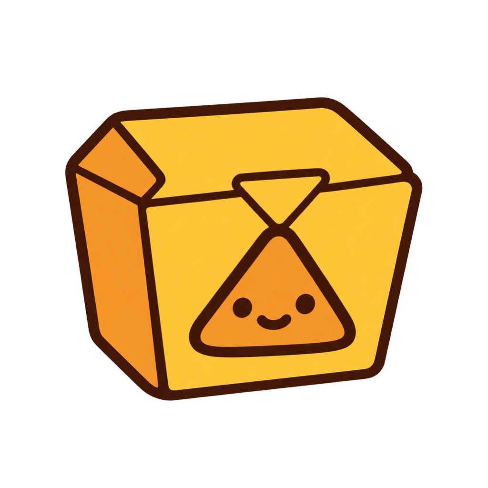
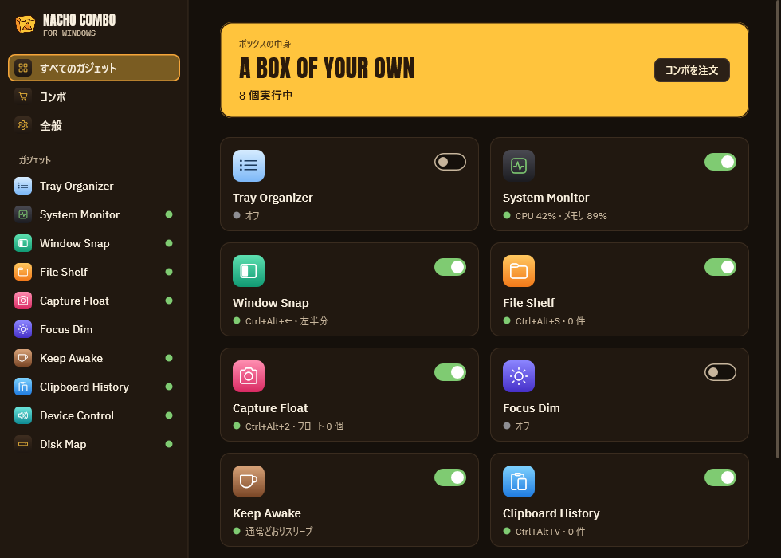
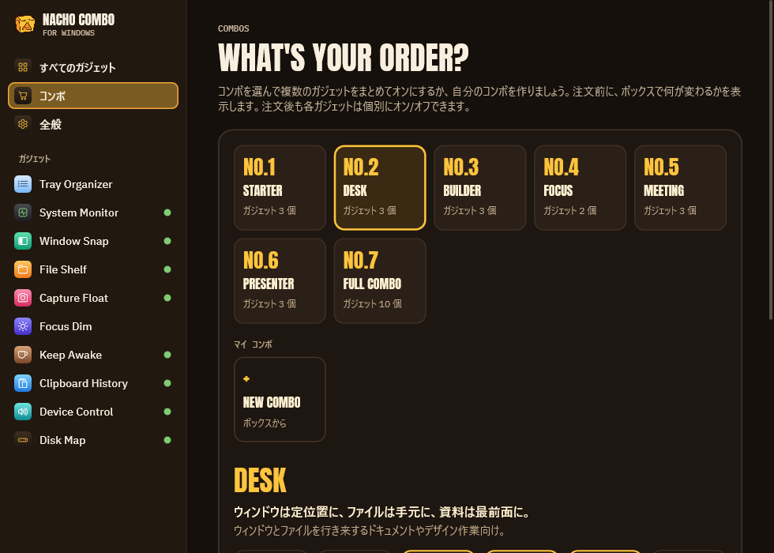
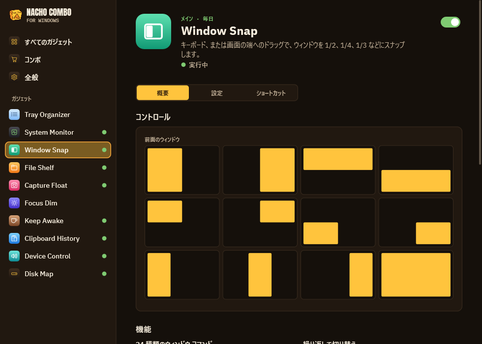
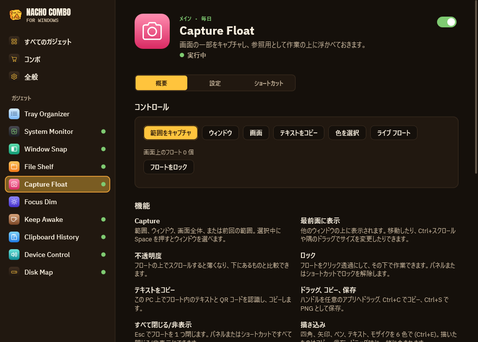
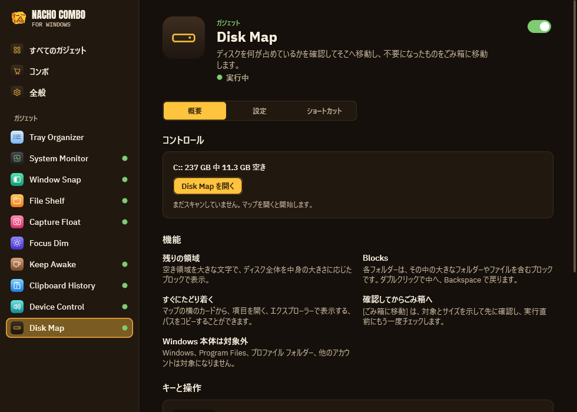
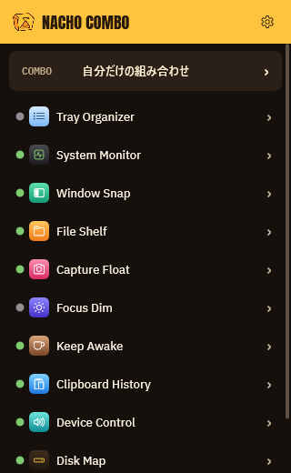

<h1 align="center">NachoCombo for Windows</h1>

<b>ひとつずつ入れていたユーティリティ十数本を、3 MB の exe ひとつに。</b>

  
  
  
  

<a href="README.md">English</a> · <a href="README.ko.md">한국어</a> · <b>日本語</b> · <a href="README.zh-Hans.md">简体中文</a>

ウィンドウの整列、書き込みできるフローティングキャプチャ、クリップボード履歴、トレイのシステムモニター、スリープ防止、
サウンドとディスプレイの操作、ドラッグ＆ドロップの棚、フォーカス用の減光、トレイの整理、ディスクマップ。ガジェットは
それぞれ単独でオン・オフでき、いくつかをまとめてコンボとして注文することもできます。

- **ポータブル：** `NachoCombo.exe` ひとつ。インストーラー、ランタイム、管理者権限、ドライバーは不要です。
- **軽量：** 複数のガジェットをオンにしても自身のメモリは約 6 MB、待機中の CPU は 0。ブラウザーエンジンを使わず
  Win32 と Direct2D で動きます。
- **プライバシー：** 自分で求めない限り、何も PC の外に出ません（グローバル IP の確認はボタン操作のみ）。
- **4 言語：** English、한국어、日本語、简体中文。Windows の言語に従い、「全般」で変更できます。

[Nacho Combo for macOS](https://github.com/mafianacho/nachocombo) の Windows 版で、デザインとロゴは同じです。

## ガジェット

| ガジェット | できること | 代わりになるもの |
|---|---|---|
| **Window Snap** | キーボードでウィンドウ操作 24 種（Ctrl+Alt+矢印、U I J K、D F G、E R T…）。繰り返すと ½ → ⅔ → ⅓ を循環、プレビュー付きドラッグ整列、元に戻す、間隔、Ctrl+Alt ドラッグで移動、右ドラッグでサイズ変更。**Win+Ctrl+T でウィンドウを最前面に固定**（黄色の枠）。同じディスプレイ構成が再接続されると、ウィンドウを元の位置に戻します。 | FancyZones、AltSnap、Always on Top |
| **Capture Float** | 範囲・ウィンドウ・画面をキャプチャ（Ctrl+Alt+2）して最前面に浮かべます。四角、矢印、ペン、文字、モザイクで**書き込み**。ホイールで薄く、固定、クリック透過のロック、コピー、保存、ドラッグで取り出し。文字や QR コードをコピー（Windows OCR）。ルーペで**色を取得**。**ライブフロート**：ほかのウィンドウの一部を動いたまま浮かべます。 | Snipaste、PixPin、Lightshot、Crop and Lock、Color Picker |
| **Clipboard History** | ポインターの位置で Ctrl+Alt+V：検索、Enter で元のアプリに貼り付け、Shift+Enter でプレーンテキスト、Ctrl+1…9、ピン留めはディスクに保存、パスワードマネージャーのコピーは記録しません。 | Ditto |
| **System Monitor** | CPU、メモリ、ディスク、ネットワーク、センサー、バッテリーをトレイにリアルタイムの数字で表示。10 分～24 時間の履歴、コアごとの負荷、上位プロセス、ボリューム、インターフェイス、アラートのパネル付き。 | TrafficMonitor |
| **Keep Awake** | カップをワンクリックで 15 分～5 時間、または指定したプログラムの実行中はスリープしません。ディスプレイも含めるか選べ、バッテリー保護付き。 | PowerToys Awake |
| **Device Control** | 出力デバイスと音量、**アプリごとの音量**、Ctrl+Alt+M ですべてのマイクをミュート、次の出力へ切り替え、接続されたらすぐ優先デバイスに、外部モニターの DDC/CI 輝度、**時刻でライト／ダークモードを切り替え**。 | EarTrumpet、Twinkle Tray、Light Switch |
| **File Shelf** | ドラッグ中に揺らすと開くフローティングの棚：ファイル、添付、画像、リンク、テキストを置いて、ひとつずつ、またはまとめて取り出せます（常にコピー）。**エクスプローラーで Space を押すと選択中のファイルをプレビュー。** | Dropover、QuickLook |
| **Focus Dim** | アクティブウィンドウの背後をディスプレイごとに暗くします。フェード、一時停止（Ctrl+Alt+Win+H）。 | HazeOver |
| **Tray Organizer** | 残さないトレイアイコンを Windows のオーバーフローメニューに畳み、また戻します。自動で畳む機能付き。オフにするとすべてのアイコンを元に戻します。 | Bartender |
| **Disk Map** | ディスクを占めているものをブロックで表示し、フォルダーに入る、開く、エクスプローラーで表示する、不要なものを承認のうえごみ箱へ移す、ができます。Windows やほかのアカウントのフォルダーは候補に出しません。 | WinDirStat、WizTree |

## コンボ

No.1 Starter、No.2 Desk、No.3 Builder、No.4 Focus、No.5 Meeting、No.6 Presenter、No.7 Full Combo、そして自分で作る
コンボを 5 つまで。注文の前に何が変わるかを見せ、5 分以内なら元に戻せます。

## もっと見る

<table>
  <tr>
    <td width="50%"> <b>Window Snap</b>：半分、4 分割、3 分割などをキーボードで。</td>
    <td width="50%"> <b>Capture Float</b>：キャプチャして、書き込み、文字をコピーし、色を取得。</td>
  </tr>
  <tr>
    <td width="50%"> <b>Disk Map</b>：ディスクを占めているものと、安全な片付け方。</td>
    <td width="50%" align="center"> <b>クイックパネル</b>：トレイからワンクリックですべてのガジェットへ。</td>
  </tr>
</table>

## インストール

1. [Releases](https://github.com/mafianacho/nachocombo-windows/releases/latest) から `NachoCombo-windows-<バージョン>-x64.zip` をダウンロードします。
2. 好きな場所に展開して `NachoCombo.exe` を実行します。
3. 「全般 ▸ サインイン時に開く」で Windows と一緒に起動します。

削除するときはトレイから終了してフォルダーを削除します。設定は `%APPDATA%\NachoCombo` にあります。

まだコード署名がないため、初回起動時に SmartScreen が「Windows によって PC が保護されました」と表示することがあります。
**詳細情報 ▸ 実行** を選んでください。ダウンロードしたファイルは `certutil -hashfile <zip> SHA256` で
`SHA256SUMS.txt` と照合できます。

## Windows が許可していないこと（と、その代わりにすること）

- **センサー：** ファン回転数やコアごとの温度にはカーネルドライバーが必要ですが、このアプリはドライバーを入れません。
  ファームウェアが報告する値（サーマルゾーン、GPU 負荷、クロック）を表示し、それ以外は「–」です。Windows には
  ロードアベレージがないため、CPU パネルはプロセッサキューの長さを表示します。プロセスごとの通信量は管理者権限が必要な
  ため表示しません。
- **Tray Organizer** は「設定 ▸ 個人用設定 ▸ タスクバー ▸ その他のシステムトレイアイコン」の裏にあるユーザーごとの
  スイッチを使います（Windows 11 22H2 以降）。非公開の仕組みなので、元の値を保存して復元します。
- **既定のサウンドデバイス**は、Windows のサウンド設定と同じ非公開インターフェイスで切り替えます。
- **Window Snap** は管理者として実行中のウィンドウを動かせません。Windows 自身のスナップがオンの間は、端へのドラッグは
  Windows に任せます。
- **File Shelf** は Windows が表示するドラッグ画像でドラッグを認識します。ドラッグ画像を出さないアプリではショートカット
  を使ってください。Space プレビューはエクスプローラーのウィンドウで動作し、デスクトップでは動作しません。

## プライバシー

このプログラムは、ユーザーまたはインストール・運用する人が明示的に求めない限り、いかなる情報もほかのネットワーク
システムへ送信しません。唯一の通信は System Monitor のグローバル IP 確認（`www.cloudflare.com/cdn-cgi/trace`）で、
確認ボタンを押すか自動確認をオンにしたときだけ行います。

## ビルド・貢献

ビルドとテストの方法は[英語の README](README.md#build--test) にあります。プルリクエストの前に
[CONTRIBUTING.md](CONTRIBUTING.md) を、脆弱性の報告は [SECURITY.md](SECURITY.md) をご覧ください。

## ライセンス

[MIT](LICENSE) © 2026 Mafianacho。「Nacho Combo」の名称とロゴはこのライセンスの対象外です。
