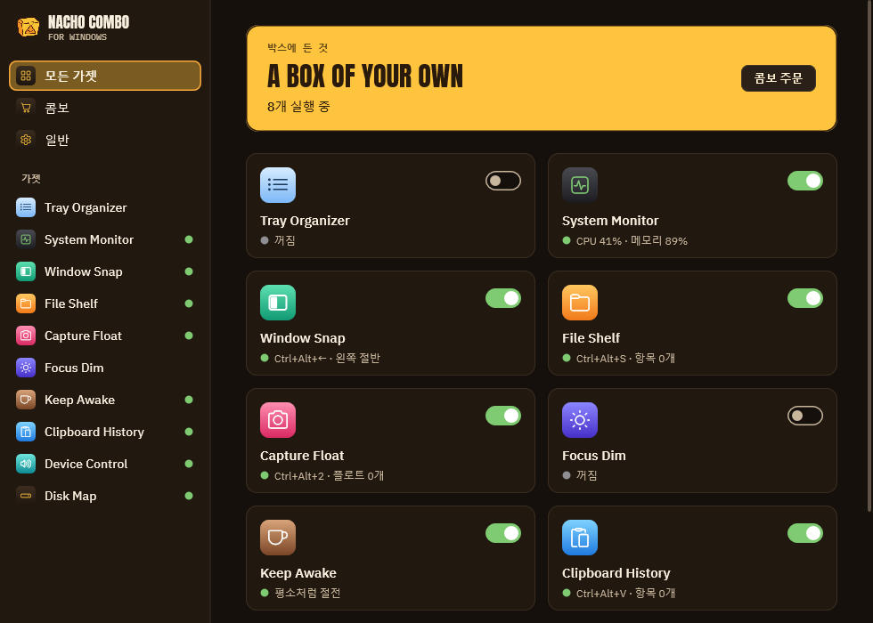
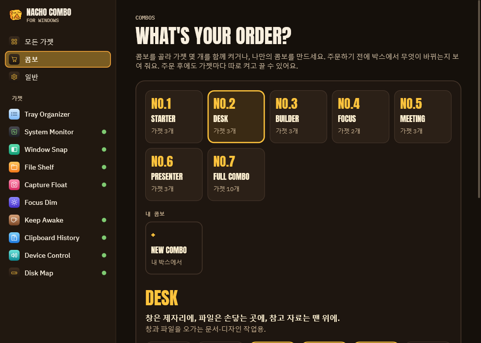
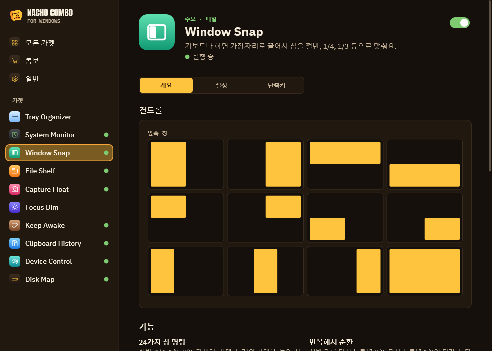
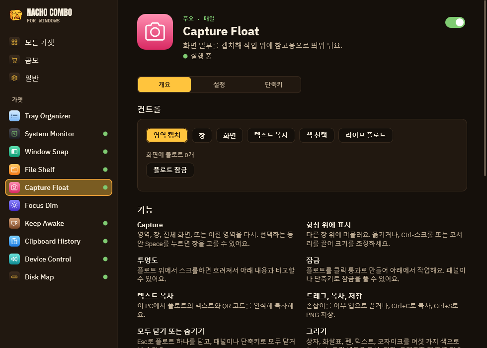
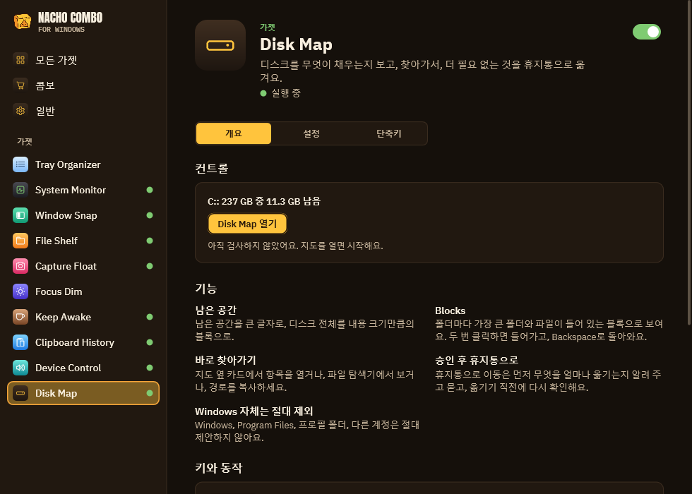
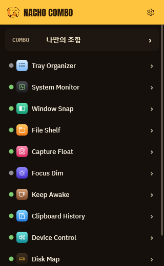

<h1 align="center">NachoCombo for Windows</h1>

<b>하나씩 따로 깔던 유틸리티 열두 개를 3MB exe 하나로.</b>

  
  
  
  

<a href="README.md">English</a> · <b>한국어</b> · <a href="README.ja.md">日本語</a> · <a href="README.zh-Hans.md">简体中文</a>

창 배치, 그림을 그릴 수 있는 떠 있는 캡처, 클립보드 기록, 트레이 시스템 모니터, 절전 방지, 소리·디스플레이 제어,
드래그 앤 드롭 선반, 집중 모드 어둡게 하기, 트레이 정리, 디스크 맵까지. 가젯마다 스위치가 따로 있고, 몇 개를 묶어
콤보로 한 번에 주문할 수도 있습니다.

- **포터블:** `NachoCombo.exe` 하나. 설치 프로그램, 런타임, 관리자 권한, 드라이버 모두 필요 없습니다.
- **가벼움:** 가젯 여러 개를 켜도 자체 메모리 약 6MB, 쉬는 동안 CPU 0. 브라우저 엔진 없이 Win32와 Direct2D로
  만들었습니다.
- **개인정보:** 직접 요청하지 않는 한 PC 밖으로 아무것도 나가지 않습니다(공인 IP 조회는 버튼을 눌러야 합니다).
- **4개 국어:** English, 한국어, 日本語, 简体中文. Windows 언어를 따르고, 일반 탭에서 바꿀 수 있습니다.

[Nacho Combo for macOS](https://github.com/mafianacho/nachocombo)의 Windows판으로, 디자인과 로고가 같습니다.

## 가젯

| 가젯 | 하는 일 | 대신하는 앱 |
|---|---|---|
| **Window Snap** | 키보드로 창 명령 24가지(Ctrl+Alt+화살표, U I J K, D F G, E R T…). 반복하면 ½ → ⅔ → ⅓로 순환, 미리 보기와 함께 드래그로 맞추기, 원래 크기로 복원, 간격, Ctrl+Alt-드래그로 이동, 오른쪽 드래그로 크기 조절. **Win+Ctrl+T로 창을 항상 위에 고정**(노란 테두리). 같은 모니터 구성이 다시 연결되면 창을 원래 자리로 돌려놓습니다. | FancyZones, AltSnap, Always on Top |
| **Capture Float** | 영역·창·화면을 캡처(Ctrl+Alt+2)해 맨 위에 띄워 둡니다. 사각형, 화살표, 펜, 글자, 모자이크로 **그 위에 그리기**. 휠로 흐리게, 고정, 클릭 통과 잠금, 복사, 저장, 드래그로 꺼내기. 글자나 QR 코드 복사(Windows OCR). 확대경으로 **색 추출**. **실시간 띄우기**: 다른 창의 일부를 움직이는 그대로 띄워 둡니다. | Snipaste, PixPin, Lightshot, Crop and Lock, Color Picker |
| **Clipboard History** | 포인터 위치에서 Ctrl+Alt+V: 검색, Enter로 원래 앱에 붙여넣기, Shift+Enter는 서식 없이, Ctrl+1…9, 고정 항목은 디스크에 보관, 비밀번호 관리자의 복사는 건너뜁니다. | Ditto |
| **System Monitor** | CPU, 메모리, 디스크, 네트워크, 센서, 배터리를 트레이에 실시간 숫자로. 10분~24시간 기록, 코어별 부하, 상위 프로세스, 볼륨, 인터페이스, 경고를 보여 주는 패널. | TrafficMonitor |
| **Keep Awake** | 컵 아이콘을 한 번 누르면 15분~5시간, 또는 지정한 프로그램이 실행되는 동안 잠들지 않습니다. 화면 포함 여부, 배터리 보호. | PowerToys Awake |
| **Device Control** | 출력 장치와 볼륨, **앱별 볼륨**, Ctrl+Alt+M으로 모든 마이크 음소거, 다음 출력 장치, 연결되자마자 선호 장치로 전환, 외부 모니터 DDC/CI 밝기, **정해진 시간에 라이트·다크 모드 전환**. | EarTrumpet, Twinkle Tray, Light Switch |
| **File Shelf** | 드래그하면서 흔들면 열리는 떠 있는 선반: 파일, 첨부, 이미지, 링크, 텍스트를 담았다가 하나씩 또는 한 번에 다시 끌어냅니다(항상 복사). **탐색기에서 Space를 누르면 선택한 파일을 미리 봅니다.** | Dropover, QuickLook |
| **Focus Dim** | 활성 창 뒤를 모니터별로 어둡게. 페이드, 일시 정지(Ctrl+Alt+Win+H). | HazeOver |
| **Tray Organizer** | 남겨 두지 않은 트레이 아이콘을 Windows 오버플로 메뉴로 접었다 펼칩니다. 자동 접기, 끄면 모든 아이콘 복원. | Bartender |
| **Disk Map** | 디스크를 채운 것을 블록으로 보고, 폴더로 들어가고, 열거나 탐색기에서 보여 주고, 필요 없는 것을 승인 후 휴지통으로 옮깁니다. Windows와 다른 계정의 폴더는 아예 제안하지 않습니다. | WinDirStat, WizTree |

## 콤보

No.1 Starter, No.2 Desk, No.3 Builder, No.4 Focus, No.5 Meeting, No.6 Presenter, No.7 Full Combo, 그리고 직접 만든
콤보 최대 5개. 주문하기 전에 무엇이 바뀌는지 먼저 보여 주고, 5분 안에는 되돌릴 수 있습니다.

## 자세히 보기

<table>
  <tr>
    <td width="50%"> <b>Window Snap</b>: 절반, 1/4, 1/3 등을 키보드로.</td>
    <td width="50%"> <b>Capture Float</b>: 캡처하고, 그리고, 글자를 복사하고, 색을 뽑습니다.</td>
  </tr>
  <tr>
    <td width="50%"> <b>Disk Map</b>: 디스크를 채운 것과 안전하게 비우는 방법.</td>
    <td width="50%" align="center"> <b>빠른 패널</b>: 트레이에서 한 번 클릭으로 모든 가젯.</td>
  </tr>
</table>

## 설치

1. [Releases](https://github.com/mafianacho/nachocombo-windows/releases/latest)에서 `NachoCombo-windows-<버전>-x64.zip`을 내려받습니다.
2. 아무 곳에나 압축을 풀고 `NachoCombo.exe`를 실행합니다.
3. 일반 ▸ 로그인할 때 열기를 켜면 Windows와 함께 시작합니다.

지우려면 트레이에서 종료하고 폴더를 삭제하면 됩니다. 설정은 `%APPDATA%\NachoCombo`에 있습니다.

아직 코드 서명이 없어서 처음 실행할 때 SmartScreen이 "Windows의 PC 보호"를 띄울 수 있습니다. **추가 정보 ▸ 실행**을
누르세요. 내려받은 파일은 `certutil -hashfile <zip> SHA256`으로 `SHA256SUMS.txt`와 비교해 확인할 수 있습니다.

## Windows가 허용하지 않는 것(그리고 대신 하는 것)

- **센서:** 팬 속도와 코어별 온도는 커널 드라이버가 필요한데, 이 앱은 드라이버를 설치하지 않습니다. 펌웨어가 알려
  주는 값(열 영역, GPU 부하, 클럭)만 보여 주고 나머지는 "–"로 표시합니다. Windows에는 load average가 없어서 CPU
  패널은 프로세서 대기열 길이를 보여 줍니다. 프로세스별 네트워크 사용량은 관리자 권한이 필요해 표시하지 않습니다.
- **Tray Organizer**는 설정 ▸ 개인 설정 ▸ 작업 표시줄 ▸ 기타 시스템 트레이 아이콘 뒤의 사용자별 스위치를 씁니다
  (Windows 11 22H2 이상). 문서화되지 않은 방식이라 원래 값을 보관했다가 복원합니다.
- **기본 소리 장치**는 Windows 소리 설정이 쓰는 것과 같은 비공개 인터페이스로 바꿉니다.
- **Window Snap**은 관리자 권한으로 실행된 창을 옮길 수 없습니다. Windows 자체 스냅이 켜져 있으면 가장자리 드래그는
  Windows에 맡깁니다.
- **File Shelf**는 Windows가 보여 주는 드래그 이미지로 드래그를 알아챕니다. 드래그 이미지가 없는 앱은 단축키를
  쓰세요. Space 미리 보기는 탐색기 창에서만 되고 바탕 화면에서는 되지 않습니다.

## 개인정보

이 프로그램은 사용자나 설치·운영하는 사람이 특별히 요청하지 않는 한 어떤 정보도 다른 네트워크 시스템으로 보내지
않습니다. 유일한 네트워크 요청은 System Monitor의 공인 IP 조회(`www.cloudflare.com/cdn-cgi/trace`)이며, 조회 버튼을
누르거나 자동 조회를 켰을 때만 보냅니다.

## 빌드·기여

빌드와 테스트 방법은 [영어 README](README.md#build--test)에 있습니다. 풀 리퀘스트 전에 [CONTRIBUTING.md](CONTRIBUTING.md)를,
보안 문제 제보는 [SECURITY.md](SECURITY.md)를 봐 주세요.

## 라이선스

[MIT](LICENSE) © 2026 Mafianacho. "Nacho Combo" 이름과 로고는 이 라이선스에 포함되지 않습니다.
