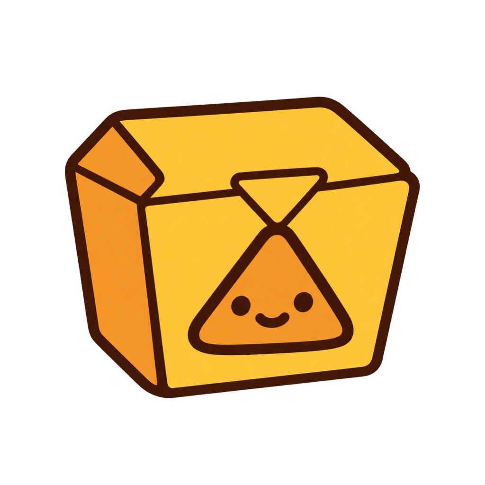
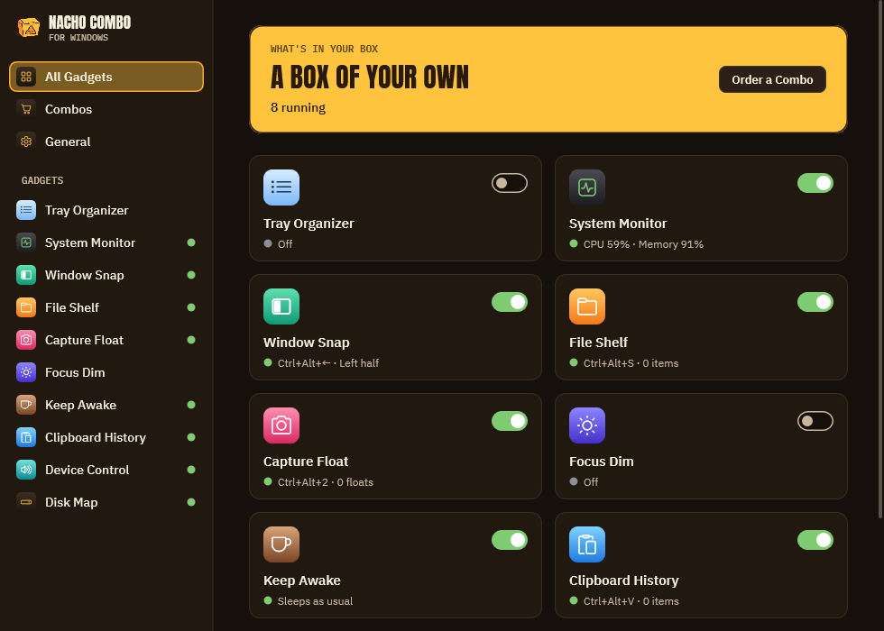
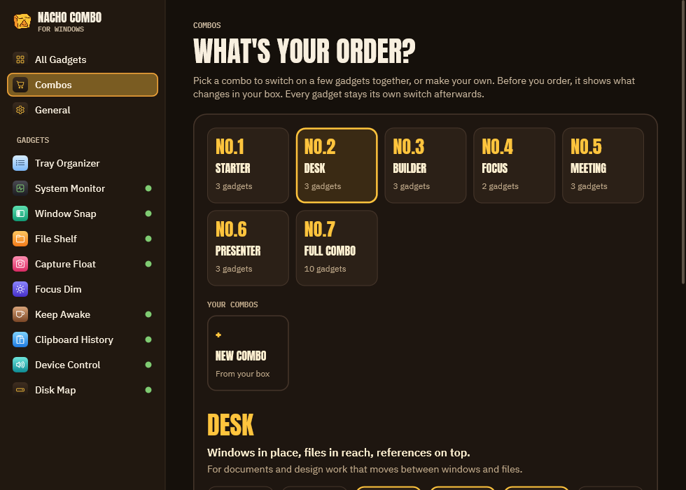
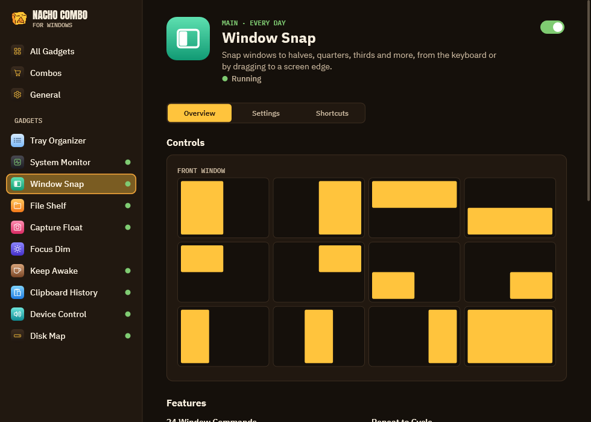
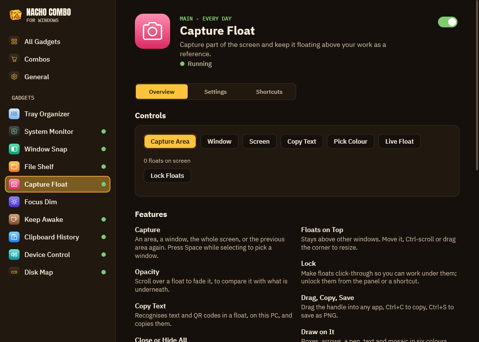
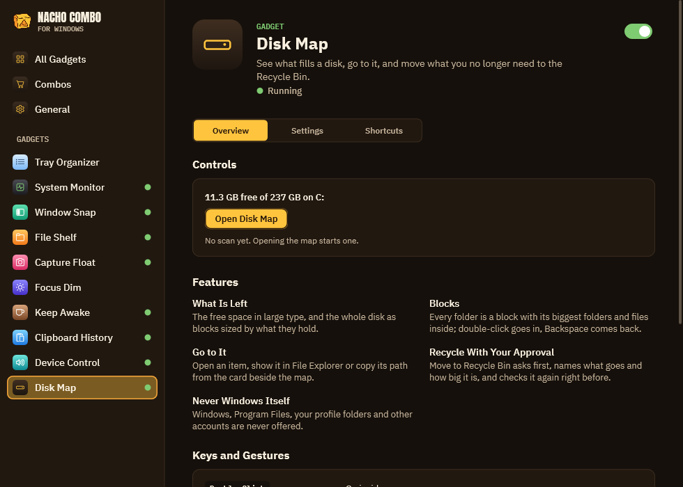
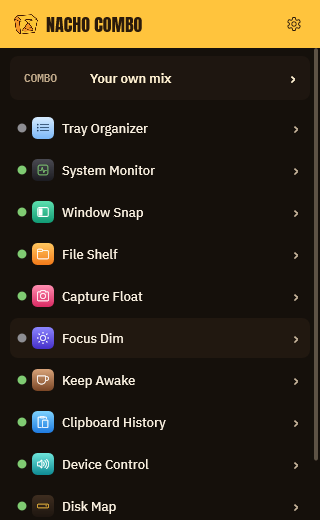

<h1 align="center">NachoCombo for Windows</h1>

<b>A dozen utilities you would otherwise install one by one, in a single 3 MB exe.</b>

  
  
  
  

<b>English</b> · <a href="README.ko.md">한국어</a> · <a href="README.ja.md">日本語</a> · <a href="README.zh-Hans.md">简体中文</a>

Window tiling, floating screenshots you can draw on, clipboard history, a tray system monitor, keep-awake, sound and
display control, a drag-and-drop shelf, focus dimming, a tidy tray and a disk map. Each gadget is its own switch, or
order a few together as a combo.

- **Portable:** one `NachoCombo.exe`. No installer, no runtime, no administrator rights, no driver.
- **Light:** about 6 MB of its own memory with several gadgets on, and no CPU while idle. Native Win32 and Direct2D, no
  browser engine.
- **Private:** nothing leaves your PC unless you ask for it (the public IP lookup is a button).
- **In your language:** English, 한국어, 日本語, 简体中文 (follows Windows, or pick one in General).

The Windows edition of [Nacho Combo for macOS](https://github.com/mafianacho/nachocombo), with the same design and logo.

## Gadgets

| Gadget | What it does | Instead of |
|---|---|---|
| **Window Snap** | 24 window commands from the keyboard (Ctrl+Alt+arrows, U I J K, D F G, E R T…), repeat to cycle ½ → ⅔ → ⅓, drag to snap with a preview, restore, gaps, Ctrl+Alt-drag to move and right-drag to resize. **Win+Ctrl+T keeps a window on top** with a yellow frame. Windows go back where they were when the same displays connect again. | FancyZones, AltSnap, Always on Top |
| **Capture Float** | Capture an area, a window or a screen (Ctrl+Alt+2) and keep it floating on top. **Draw on it**: boxes, arrows, pen, text and mosaic. Fade it with the wheel, pin it, lock it click-through, copy, save, drag it out. Copy its text or QR code (Windows OCR). **Pick a colour** with a loupe. **Live float**: keep part of another window floating and moving. | Snipaste, PixPin, Lightshot, Crop and Lock, Color Picker |
| **Clipboard History** | Ctrl+Alt+V at the pointer: search, Enter pastes into the app you were in, Shift+Enter as plain text, Ctrl+1…9, pins kept on disk, password-manager copies skipped. | Ditto |
| **System Monitor** | CPU, memory, disk, network, sensors and battery as live numbers in the tray, with panels: history from 10 min to 24 h, per-core load, top processes, volumes, interfaces, alerts. | TrafficMonitor |
| **Keep Awake** | One click on the cup, for 15 min to 5 h, or while chosen programs run; the display too or not; a battery guard. | PowerToys Awake |
| **Device Control** | Sound output and volume, **volume per app**, Ctrl+Alt+M mutes every microphone, next output, preferred devices taken as soon as they connect, DDC/CI brightness for external monitors, **light and dark mode on a schedule**. | EarTrumpet, Twinkle Tray, Light Switch |
| **File Shelf** | A floating shelf that opens when you shake a drag: files, attachments, images, links and text; drag one or all out again (always a copy). **Space in File Explorer previews the selected file.** | Dropover, QuickLook |
| **Focus Dim** | Dims everything behind the active window, per display, with fade and pause (Ctrl+Alt+Win+H). | HazeOver |
| **Tray Organizer** | Folds the tray icons you did not keep into Windows' overflow menu and brings them back, with auto-collapse; restores every icon when switched off. | Bartender |
| **Disk Map** | See what fills a disk as blocks, go into a folder, open it or show it in File Explorer, and move what you no longer need to the Recycle Bin after you approve. Windows and other accounts' folders are never offered. | WinDirStat, WizTree |

## Combos

No.1 Starter, No.2 Desk, No.3 Builder, No.4 Focus, No.5 Meeting, No.6 Presenter, No.7 Full Combo, and up to five of
your own. Ordering shows what changes first and can be undone for five minutes.

## A closer look

<table>
  <tr>
    <td width="50%"> <b>Window Snap</b>: halves, quarters, thirds and more from the keyboard.</td>
    <td width="50%"> <b>Capture Float</b>: capture, draw on it, copy its text, pick a colour.</td>
  </tr>
  <tr>
    <td width="50%"> <b>Disk Map</b>: what fills the disk, and a safe way to clear it.</td>
    <td width="50%" align="center"> <b>Quick panel</b>: every gadget one click from the tray.</td>
  </tr>
</table>

## Install

1. Download `NachoCombo-windows-<version>-x64.zip` from [Releases](https://github.com/mafianacho/nachocombo-windows/releases/latest).
2. Unzip it anywhere and run `NachoCombo.exe`.
3. General ▸ Open at Sign-In starts it with Windows.

To remove it, quit it from the tray and delete the folder; settings live in `%APPDATA%\NachoCombo`.

The exe is not code-signed yet, so SmartScreen may say "Windows protected your PC" on the first launch: choose
**More info ▸ Run anyway**. Check the download with `certutil -hashfile <zip> SHA256` against `SHA256SUMS.txt`.

## What Windows does not allow (and what the app does instead)

- **Sensors:** fans and per-core temperatures need a kernel driver, which this app refuses to install. It shows what the
  firmware reports (thermal zones, GPU load, clock) and "–" for the rest. Windows has no load average: the CPU panel shows
  the processor queue length. Per-process network traffic needs administrator rights and is not shown.
- **Tray Organizer** uses the per-user switch behind Settings ▸ Personalization ▸ Taskbar ▸ Other system tray icons
  (Windows 11 22H2 or later). It is undocumented; the original values are kept and restored.
- **Default sound device** is chosen through the same undocumented interface Windows' Sound settings use.
- **Window Snap** cannot move windows that run as administrator. While Windows' own Snap is on, edge drags are left to it.
- **File Shelf** recognises a drag by the drag image Windows shows; apps that drag without one need the shortcut. Space
  previews work in File Explorer windows, not on the desktop.

## Privacy

This program will not transfer any information to other networked systems unless specifically requested by the user or
the person installing or operating it. The only network request is the public IP lookup in System Monitor
(`www.cloudflare.com/cdn-cgi/trace`), made when you press Look Up or turn on automatic lookup.

## Build / test

- `cargo test` runs the logic tests (layouts, shortcuts, settings, combos, alerts, history, shelf, translations).
- `cargo build --release` gives `target/release/NachoCombo.exe`. It needs the MSVC build tools and the Windows SDK
  (`rc.exe` embeds the icon, the per-monitor DPI manifest and the version).
- Translations: `assets/i18n/<lang>.json` maps the English text to the language's; text with `{}` is a pattern.
- Set `NACHOCOMBO_DIR` to keep settings in another folder (for tests).
- Debug control channel: start with `NachoCombo.exe --debug-ctl`, then for example `NachoCombo.exe ctl set snap on`,
  `ctl snap left`, `ctl combo order desk`, `ctl gallery page devices`, `ctl snapshot settings out.png`, `ctl quit`. Each
  command prints the state JSON.
- Releases: bump `version` in `Cargo.toml`, then push a tag `v<version>`. The workflow checks that they match, builds the
  zip and publishes the release.

See [CONTRIBUTING.md](CONTRIBUTING.md) before opening a pull request, and [SECURITY.md](SECURITY.md) to report a
vulnerability.

## License

[MIT](LICENSE) © 2026 Mafianacho. The "Nacho Combo" name and logo are not covered by this license.
