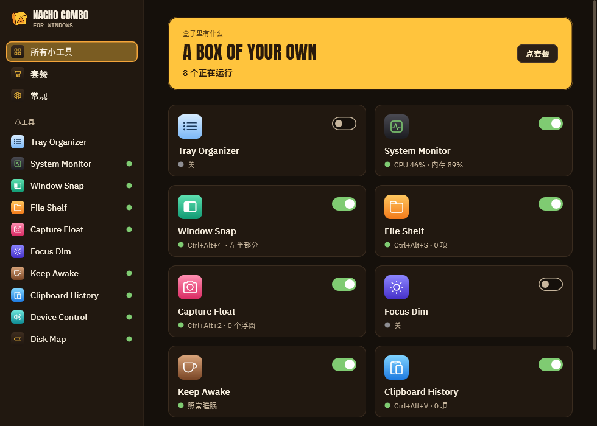
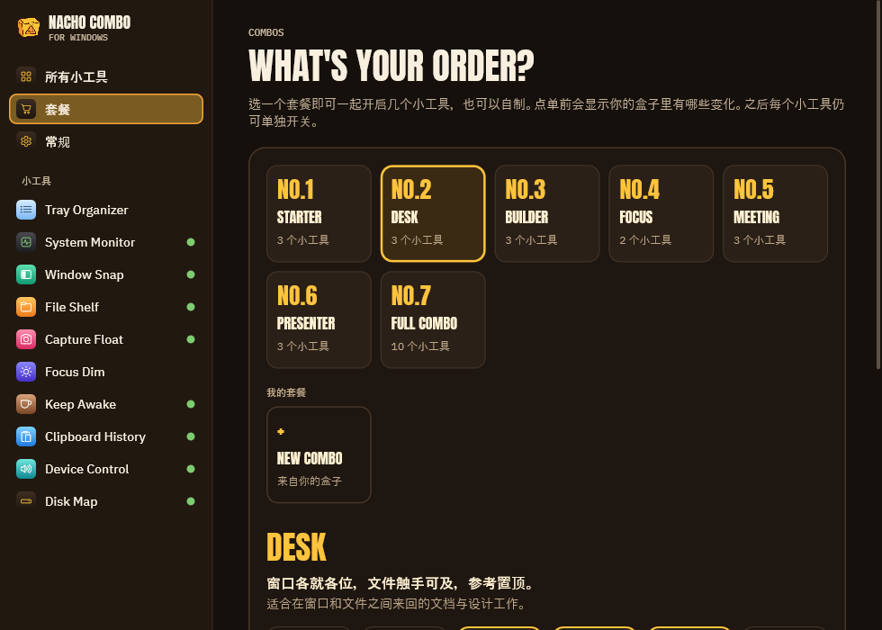
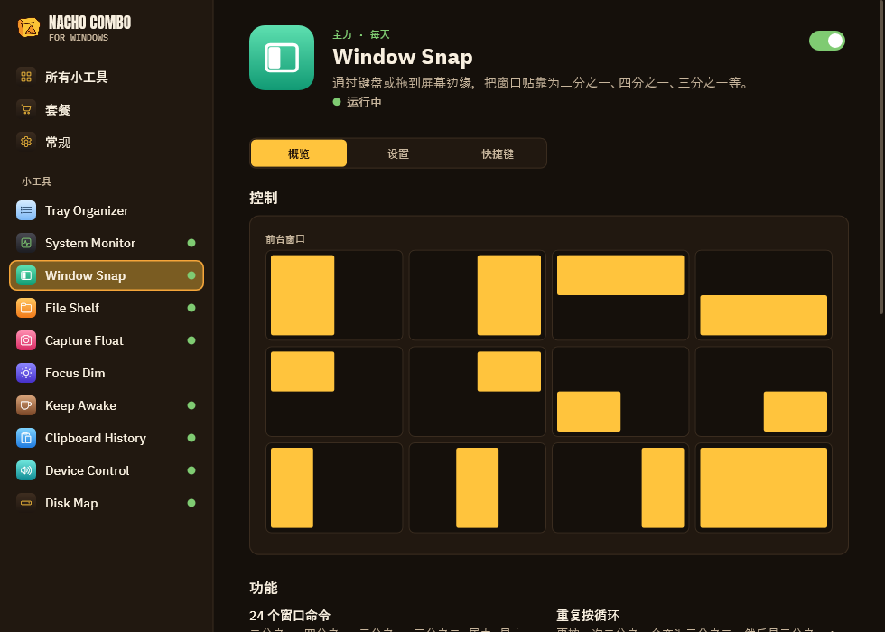
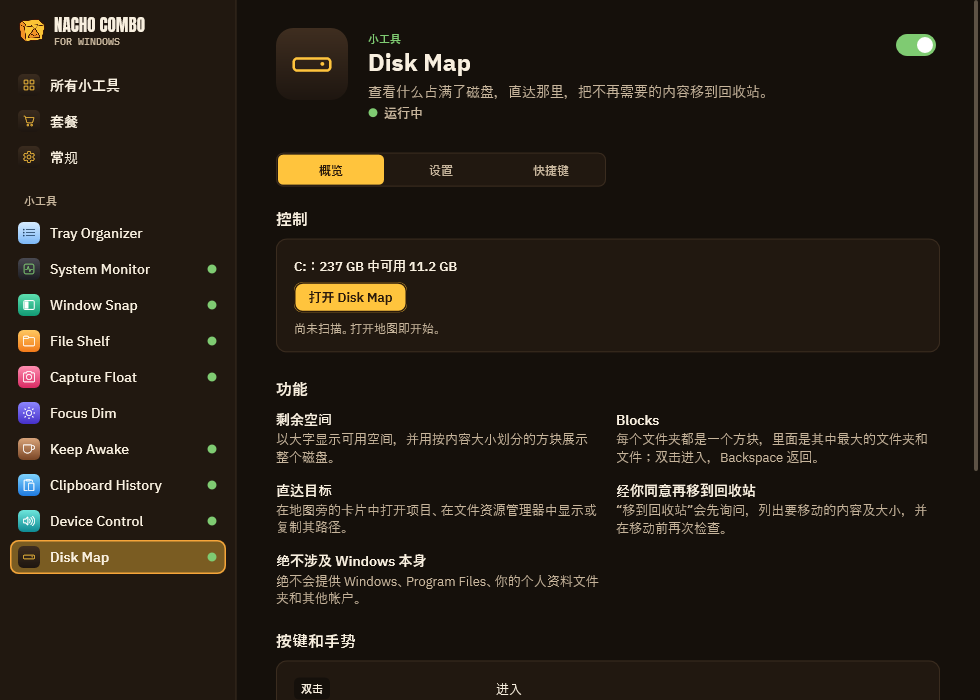
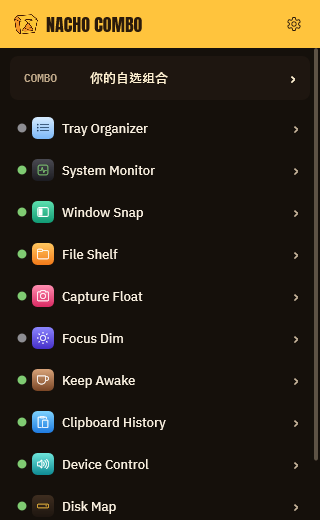

<h1 align="center">NachoCombo for Windows</h1>

<b>原本要一个个安装的十几个小工具，装进一个 3 MB 的 exe。</b>

  
  
  
  

<a href="README.md">English</a> · <a href="README.ko.md">한국어</a> · <a href="README.ja.md">日本語</a> · <b>简体中文</b>

窗口布局、可以标注的浮动截图、剪贴板历史、托盘系统监视器、防止休眠、声音与显示器控制、拖放暂存架、专注调暗、
托盘整理和磁盘地图。每个小工具都可以单独开关，也可以把几个组合成套餐一次点单。

- **便携：** 只有一个 `NachoCombo.exe`。无需安装程序、运行库、管理员权限或驱动。
- **轻量：** 开启多个小工具时自身内存约 6 MB，空闲时不占 CPU。基于 Win32 和 Direct2D，没有浏览器引擎。
- **隐私：** 除非你主动要求，任何数据都不会离开你的电脑（公网 IP 查询需要点按钮）。
- **四种语言：** English、한국어、日本語、简体中文。默认跟随 Windows，也可以在“常规”中切换。

这是 [Nacho Combo for macOS](https://github.com/mafianacho/nachocombo) 的 Windows 版，设计和图标相同。

## 小工具

| 小工具 | 功能 | 可以替代 |
|---|---|---|
| **Window Snap** | 用键盘执行 24 种窗口命令（Ctrl+Alt+方向键、U I J K、D F G、E R T…），重复按下在 ½ → ⅔ → ⅓ 之间循环，带预览的拖动吸附、还原、间距、Ctrl+Alt 拖动移动、右键拖动调整大小。**Win+Ctrl+T 让窗口保持置顶**（黄色边框）。同一组显示器重新连接时，窗口会回到原来的位置。 | FancyZones、AltSnap、Always on Top |
| **Capture Float** | 截取区域、窗口或整个屏幕（Ctrl+Alt+2）并浮在最上层。用方框、箭头、画笔、文字和马赛克**在上面标注**。滚轮调淡、固定、锁定为点击穿透、复制、保存、拖出。复制其中的文字或二维码（Windows OCR）。用放大镜**取色**。**实时浮窗**：让另一个窗口的一部分保持实时浮动。 | Snipaste、PixPin、Lightshot、Crop and Lock、Color Picker |
| **Clipboard History** | 在指针处按 Ctrl+Alt+V：搜索，Enter 粘贴到原来的应用，Shift+Enter 粘贴纯文本，Ctrl+1…9，固定项保存在磁盘上，跳过密码管理器的复制。 | Ditto |
| **System Monitor** | 在托盘中实时显示 CPU、内存、磁盘、网络、传感器和电池数值，并提供面板：10 分钟到 24 小时的历史、每核负载、占用最高的进程、卷、网络接口和警报。 | TrafficMonitor |
| **Keep Awake** | 点一下杯子即可保持唤醒 15 分钟到 5 小时，或在指定程序运行期间保持唤醒；可选是否包括显示器；带电池保护。 | PowerToys Awake |
| **Device Control** | 输出设备和音量、**按应用调节音量**、Ctrl+Alt+M 静音所有麦克风、切换到下一个输出、首选设备一连接就切换、外接显示器 DDC/CI 亮度、**按时间切换浅色和深色模式**。 | EarTrumpet、Twinkle Tray、Light Switch |
| **File Shelf** | 拖动时晃一晃就会打开的浮动暂存架：放入文件、附件、图片、链接和文字，再逐个或一起拖出（始终是复制）。**在文件资源管理器中按空格键预览所选文件。** | Dropover、QuickLook |
| **Focus Dim** | 按显示器调暗活动窗口后面的一切，支持淡入淡出和暂停（Ctrl+Alt+Win+H）。 | HazeOver |
| **Tray Organizer** | 把不需要常驻的托盘图标收进 Windows 的溢出菜单，也能再展开，支持自动收起；关闭时恢复所有图标。 | Bartender |
| **Disk Map** | 用方块查看是什么占满了磁盘，进入文件夹、打开或在文件资源管理器中显示，经你确认后把不再需要的内容移到回收站。从不建议 Windows 和其他账户的文件夹。 | WinDirStat、WizTree |

## 套餐

No.1 Starter、No.2 Desk、No.3 Builder、No.4 Focus、No.5 Meeting、No.6 Presenter、No.7 Full Combo，以及最多五个自定义
套餐。点单前先显示会有哪些变化，五分钟内可以撤销。

## 细看

<table>
  <tr>
    <td width="50%"> <b>Window Snap</b>：用键盘把窗口排成一半、四分之一、三分之一等。</td>
    <td width="50%"> <b>Capture Float</b>：截图、标注、复制文字、取色。</td>
  </tr>
  <tr>
    <td width="50%"> <b>Disk Map</b>：看清是什么占满了磁盘，并安全地清理。</td>
    <td width="50%" align="center"> <b>快捷面板</b>：从托盘一键打开所有小工具。</td>
  </tr>
</table>

## 安装

1. 从 [Releases](https://github.com/mafianacho/nachocombo-windows/releases/latest) 下载 `NachoCombo-windows-<版本>-x64.zip`。
2. 解压到任意位置，运行 `NachoCombo.exe`。
3. 在“常规 ▸ 登录时打开”中设置随 Windows 启动。

卸载时从托盘退出并删除文件夹即可；设置保存在 `%APPDATA%\NachoCombo`。

exe 暂未进行代码签名，首次运行时 SmartScreen 可能会提示“Windows 已保护你的电脑”：请选择**更多信息 ▸ 仍要运行**。
可以用 `certutil -hashfile <zip> SHA256` 与 `SHA256SUMS.txt` 对比来校验下载的文件。

## Windows 不允许的事（以及应用的替代做法）

- **传感器：** 风扇转速和每核温度需要内核驱动，本应用不会安装驱动。它显示固件报告的数据（热区、GPU 负载、频率），
  其余显示为“–”。Windows 没有平均负载，CPU 面板显示处理器队列长度。按进程统计网络流量需要管理员权限，因此不显示。
- **Tray Organizer** 使用“设置 ▸ 个性化 ▸ 任务栏 ▸ 其他系统托盘图标”背后的按用户开关（Windows 11 22H2 或更高版本）。
  这是未公开的机制，原始值会被保存并恢复。
- **默认声音设备**通过与 Windows 声音设置相同的未公开接口切换。
- **Window Snap** 无法移动以管理员身份运行的窗口。Windows 自带的贴靠开启时，拖到屏幕边缘交给 Windows 处理。
- **File Shelf** 通过 Windows 显示的拖动图像识别拖动；不显示拖动图像的应用请使用快捷键。空格预览只在文件资源管理器
  窗口中有效，在桌面上无效。

## 隐私

除非用户或安装、运营本程序的人明确要求，本程序不会向其他网络系统传输任何信息。唯一的网络请求是 System Monitor 的
公网 IP 查询（`www.cloudflare.com/cdn-cgi/trace`），只在你点击查询或开启自动查询时发出。

## 构建与贡献

构建和测试方法见[英文 README](README.md#build--test)。提交拉取请求前请阅读 [CONTRIBUTING.md](CONTRIBUTING.md)，
报告安全漏洞请见 [SECURITY.md](SECURITY.md)。

## 许可证

[MIT](LICENSE) © 2026 Mafianacho。“Nacho Combo”名称和图标不在此许可证范围内。
